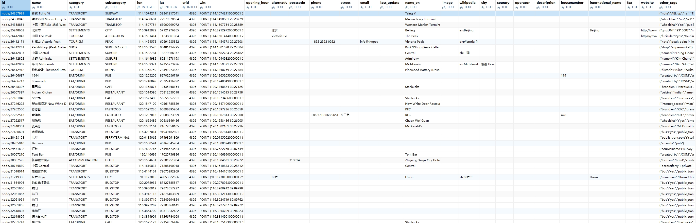

# poi
本项目提供Openstreetmap数据提取为poi数据集的代码，并开源数据集。

本项目收集国内POI兴趣点，当前版本数据来自于openstreetmap。
本数据库包含的数据结构如下：



## 使用方法
可下载此数据至本地，并结合离线地图引擎[青罗](https://github.com/qmjy/Chilo)发布进行使用,使用指导请参考Chilo相关教程。

## 运行程序

```bash
java -Xmx2g -jar ./target/poi-1.0.0-SNAPSHOT.jar <filePath> <fileType> [outputType]
```

| 参数 | 含义 | 示例 |
| --- | --- | --- |
| `filePath` | 待解析的 OSM 文件路径 | `D:/test/data/latest.osm.pbf` |
| `fileType` | 输入文件格式，取值 `OSM_PBF` 或 `OSM_XML`（大小写不敏感） | `OSM_PBF` |
| `outputType` | 可选，输出类型，缺省为 `0` | `1` |

`outputType` 取值：

| 取值 | 输出内容 |
| --- | --- |
| `0`（默认） | `.csv` 文件 + SQLite 数据库文件（`*.poi`） |
| `1` | 仅 SQLite 数据库文件（`*.poi`） |
| `2` | 仅 `.csv` 文件 |

也支持键值对写法，顺序任意：`filePath=... fileType=... outputType=...`。

运行时目录规则：

- **输入文件**：待抽取的osm文件路径；
- **输出目录**：默认就是 `xxx.osm.pbf` 文件所在的目录；

Windows 下可直接双击 `Extract.bat` 运行示例。


## 输出格式

提取程序可输出 `|` 分隔的 `.csv` 文件，也可**直接把结果写入 SQLite 数据库文件**。
SQLite文件以数据集命名并以 `.poi` 结尾（例如 `hong_kong.poi`）。
输出哪些格式由命令行参数 `outputType` 决定（见上表），默认为全部输出。

- 数据表名固定为 `poi`，字段与 `.csv` 表头一一对应（`ID`、`NAME`、`CATEGORY`、`SUBCATEGORY`、`LON`、`LAT`、`SRID`、`WKT`，以及属性映射列和 `OTHER_TAGS`）；
- `LON`/`LAT` 为 `REAL`，`SRID` 为 `INTEGER`，其余为 `TEXT`；几何以 WKT 文本存储；
- 自动为 `ID` 与 `NAME` 建立索引，便于按标识或名称快速检索；
- 每次执行都会重建该文件，与 `.csv` 的行为保持一致；若本次没有任何记录写入，则不会产生空文件。

查询示例：

```sql
SELECT ID, NAME, CATEGORY, SUBCATEGORY, LON, LAT
FROM poi
WHERE CATEGORY = 'EAT/DRINK' AND SUBCATEGORY = 'RESTAURANT'
ORDER BY NAME;
```

```bash
java -DLOG_LEVEL=DEBUG -DLOG_DIR=D:/logs -jar target/poi-1.0.0-SNAPSHOT.jar <filePath> <fileType> [outputType]
```

| 参数 | 含义 | 默认值 |
| --- | --- | --- |
| `-DLOG_LEVEL` | 项目日志级别（`TRACE`/`DEBUG`/`INFO`/`WARN`/`ERROR`） | `INFO` |
| `-DLOG_DIR` | 日志文件所在目录 | `./logs` |

## 感谢
本项目从[OSMWrangle](https://github.com/SLIPO-EU/OSMWrangle)继承优化而来，感谢原项目团队。